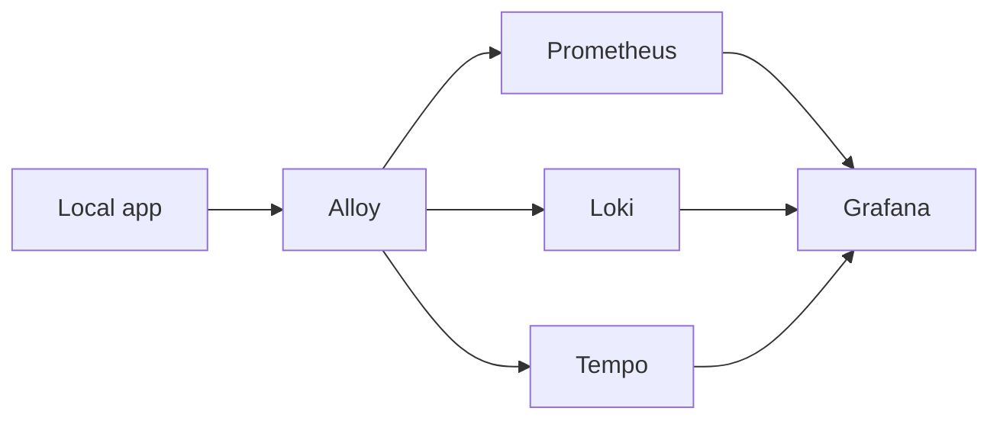

# Optional local observability

Observability is optional developer tooling for the local Docker stack. It is disabled for the LocalSingleNode demo deployment, and the demo does not depend on Grafana, metrics, logs, or traces for readiness or CRUD behavior.

## Local flow

When the optional profile is enabled, the app sends telemetry to Alloy. Alloy forwards metrics to Prometheus, logs to Loki, and traces to Tempo. Grafana queries those local stores. All service ports bind to loopback; never publish them.

The local Compose profile and its limits live in [`docker-compose.yml`](../../docker-compose.yml) and [`docker/observability`](../../docker/observability). App instrumentation is in [`ObservabilityExtensions.cs`](../../GrumPlates/Infrastructure/Hosting/ObservabilityExtensions.cs). The deployment settings keep `observability_enabled: false`.

Telemetry export is best-effort. A missing collector or failed export must not prevent app startup, readiness, or requests. Keep metric labels bounded; do not include user or record IDs, email addresses, full URLs, query strings, request or trace IDs, IP addresses, or free text.
